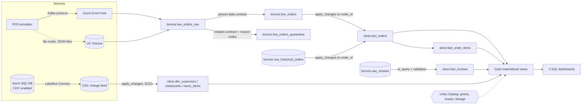

# Restaurant Chain Lakehouse: Streaming, CDC and AI on Azure Databricks

A governed data lakehouse for a five-location restaurant chain. It combines **real-time point-of-sale (POS) events** and **batch/CDC database data** into a Medallion architecture (Bronze → Silver → Gold), enriches customer reviews with an **LLM** (`ai_query`), and serves two BI dashboards, with data contracts, quarantine, idempotent upserts, an LLM evaluation harness, PII masking and CI.

## Table of contents
1. [Project status and scope](#project-status-and-scope) · 2. [Business problem](#business-problem) · 3. [Architecture](#architecture) · 4. [How data flows](#how-data-flows-end-to-end) · 5. [Tech stack](#tech-stack-and-why) · 6. [Data model](#data-model) · 7. [Engineering concepts explained](#engineering-concepts-explained) · 8. [Repository structure](#repository-structure) · 9. [Run it locally](#run-it-locally-no-cloud-needed) · 10. [Deploy to Databricks](#deploy-to-databricks) · 11. [Testing and CI](#testing-and-ci) · 12. [Limitations](#limitations-and-next-steps) · 13. [Glossary](#glossary)

## Project status and scope
- **What this is:** a reference implementation of the architecture on **fully synthetic data** (no real customer or business data).
- **Runs locally and in CI on every push:** the data generators, POS simulator, data-contract validator, LLM evaluation harness and unit tests (`python -m unittest`).
- **Reference code for a Databricks/Azure workspace:** the pipelines, SQL, governance scripts and the Asset Bundle are written to be deployed with the commands in [Deploy to Databricks](#deploy-to-databricks). CI has no cloud workspace, so these are not executed by CI.
- **History:** the solution was originally developed on free-trial Azure/Databricks subscriptions that have since expired. Azure-only sources (Event Hub, Azure SQL CDC) are therefore documented as designs, and the pipelines include a **file-based source mode** so the same logic can run without them.

## Business problem
The chain's operational data was fragmented: orders, customers, menu and reviews lived in a relational database, and live POS events had no analytical home. Management had no real-time visibility, reviews were read by hand, and there was no governance or customer-level intelligence. Goal: **one governed platform for data, AI and BI**, answering "how is each location performing right now?", "what are customers unhappy about?" and "who are our most valuable customers?".

## Architecture


## How data flows end to end
1. **Generate/produce.** `src/generators/generate_batch_data.py` creates customers, restaurants, menu items, historical orders and reviews. `src/simulator/pos_simulator.py` emits one POS order event at a time (default every 3 seconds) either to **Azure Event Hub** (`--mode eventhub`) or as **JSON files** into a folder/Volume (`--mode files`). It can inject malformed events and duplicates on purpose.
2. **Land raw (Bronze).** `01_bronze_live_orders.py` reads the stream (Kafka endpoint of Event Hub, or Auto Loader over the Volume) into `live_orders_raw`, keeping the **raw JSON string unchanged** for replay.
3. **Enforce the contract.** The raw JSON is parsed and checked against eight rules (IDs present, timestamp parses, amount > 0, order type/status valid, items is a JSON array). Valid events go to `live_orders`; invalid events go to `live_orders_quarantine` with **reason codes** (e.g. `amount_positive,order_type_valid`).
4. **Build Silver.** `fact_orders` is fed by two flows (live and historical) using `apply_changes` keyed on `order_id`, so duplicates collapse. `fact_order_items` explodes the JSON `items` array to one row per line item. Dimensions are upserted from the CDC feed (SCD Type 1). `fact_reviews` calls an LLM to produce sentiment and issue flags.
5. **Build Gold.** Materialized views compute daily sales, per-restaurant sales, a customer 360 profile (loyalty tiers, favourites) and review metrics.
6. **Serve.** Dashboard queries in `sql/03_dashboard_queries.sql` read Gold from a SQL warehouse.
7. **Orchestrate.** `databricks.yml` defines two triggered pipelines and a daily job (ingest+silver → gold) with failure e-mail alerts.

## Tech stack and why
| Layer | Tools | Why |
|---|---|---|
| Streaming source | Azure Event Hub (Kafka-compatible endpoint) | Spark's standard Kafka connector works unchanged; no Kafka cluster to run |
| Batch/CDC source | Azure SQL Database with CDC, Lakeflow Connect | Managed incremental ingestion without custom triggers or MERGE code |
| Processing | Spark Declarative Pipelines (Lakeflow), PySpark, Delta Lake | Declare tables; the platform handles dependencies, checkpoints, retries, incremental processing |
| AI | `ai_query()` (Mosaic AI model serving) | LLM inference inside a SQL statement, governed and lineage-tracked |
| Governance | Unity Catalog (grants, masks, volumes, lineage) | One access-control and lineage layer across all layers |
| Orchestration & IaC | Databricks Workflows + Asset Bundles | Version-controlled, repeatable deployment |
| Serving | SQL warehouse + dashboards | Fast reads over pre-aggregated Gold |
| Tests/CI | Python `unittest`, GitHub Actions | Fast checks on the logic that doesn't need a cluster |

## Data model
**Bronze** (as received): `live_orders_raw` · `live_orders` · `live_orders_quarantine` · `raw_historical_orders` · `raw_reviews`

**Silver** (typed, modelled star schema)
| Table | Grain | Notes |
|---|---|---|
| `fact_orders` | one row per order | adds `order_date`, `order_hour`, `day_of_week`, `is_weekend`, `item_count`; decimal money |
| `fact_order_items` | one row per order line | exploded from the JSON `items` array |
| `fact_reviews` | one row per review | LLM sentiment, four issue flags, reason, `ai_json_valid`, `prompt_version` |
| `dim_customers`, `dim_restaurants`, `dim_menu_items` | one row per entity | SCD Type 1 via CDC |

**Gold** (materialized views): `daily_sales_summary` · `restaurant_daily_sales` · `customer_360_profile` · `restaurant_review_metrics`

## Engineering concepts explained
**1. Data contract with a dead-letter table.** `src/contracts/order_event.schema.json` states what a valid event is. Instead of silently dropping bad events, the pipeline writes them to `live_orders_quarantine` with reason codes, so producer bugs are visible and the raw payload is kept. `src/contracts/validate.py` applies the same contract in Python and returns codes such as `missing:customer_id` or `range:total_amount`; a test checks that every contract field is covered by the pipeline rules.

**2. Idempotent ingestion (effectively-once).** Event streams are *at-least-once*: the same event can arrive twice. `fact_orders` is built with `apply_changes(keys=["order_id"])`, so re-delivery overwrites the same row instead of duplicating it. The same mechanism merges live and historical orders into one table, replacing a `UNION ALL` plus manual de-duplication.

**3. One pipeline, two sources.** `source_mode=eventhub|files` switches the Bronze reader. Downstream logic is identical, so the project can run with or without Azure Event Hub.

**4. Treating the LLM as an untrusted component.** `04_silver_reviews_ai.sql` isolates the model call in a CTE, extracts the JSON object with a regex (models often add prose or code fences), validates enum values, and stores `ai_json_valid` and `prompt_version`. `eval/sentiment_eval.py` scores any model output against a labelled golden set and a keyword baseline (JSON-validity rate, sentiment accuracy, per-issue precision and recall), so a prompt or model change can be judged by numbers. In the included synthetic data the keyword baseline over-flags praise such as "great portion" as a portion complaint, which is exactly the kind of error the evaluation is meant to expose.

**5. Expectation policy by blast radius.** Fact rows that fail checks are **dropped** (isolated damage). A null dimension key **fails** the pipeline (it would corrupt every downstream join). AI-derived sentiment only **warns** (non-critical, monitored in the event log).

**6. Governance as code.** `sql/00_uc_setup.sql` creates the catalog, schemas and volumes; grants BI readers access to Gold only; defines a **column mask** that hides e-mail/phone unless the user is in `pii_readers`; and includes a **row-filter** pattern so a location manager sees only their restaurant.

**7. Observability.** `sql/02_observability.sql` has ready-made checks: quarantine rate, freshness (minutes since the newest live order) and AI parse-failure rate, suitable for SQL alerts.

**8. Triggered pipelines in the daily DAG.** A continuous stream never "completes", so downstream tasks would never start. Pipelines are `continuous: false`: each run drains available data and stops, which also controls cost.

**9. Liquid clustering.** Gold and fact tables use `CLUSTER BY` instead of date partitioning; partitioning small or medium tables by day creates many small files.

## Repository structure
```
├── databricks.yml                  # Asset Bundle: pipelines, daily job, dev/prod targets
├── src/
│   ├── generators/generate_batch_data.py
│   ├── simulator/pos_simulator.py  # files or Event Hub mode; bad/duplicate event injection
│   ├── contracts/                  # order_event.schema.json + validate.py
│   └── pipelines/                  # 01 bronze, 02 dims (CDC), 03 facts, 04 reviews (AI), 05 gold
├── sql/                            # UC setup, CDC enablement, observability, dashboard queries
├── eval/sentiment_eval.py          # LLM evaluation harness
├── tests/                          # 10 unit tests
├── docs/DESIGN_DECISIONS.md        # ADR-style rationale
└── .github/workflows/ci.yml
```

## Run it locally (no cloud needed)
Requires Python 3.10+ and no third-party packages.
```bash
# 1) Generate batch data (customers, restaurants, menu, orders, reviews)
python -m src.generators.generate_batch_data --out data/batch --orders 5000

# 2) Emit live POS events as JSON files (5% malformed, 3% duplicates)
python -m src.simulator.pos_simulator --mode files --out data/live --count 50 --interval 0.1

# 3) Score the keyword baseline for review enrichment against the golden labels
python -m eval.sentiment_eval --reviews data/batch/reviews.csv

# 4) Run the unit tests
python -m unittest discover -s tests -t . -v
```
To score an LLM instead, save its outputs as JSON lines `{"review_id": "...", "raw": "<model output>"}` and add `--predictions file.jsonl`.

## Deploy to Databricks
Prerequisites: a Unity Catalog-enabled workspace, the Databricks CLI, and a model-serving endpoint for `ai_query`.
1. Run `sql/00_uc_setup.sql` in a SQL editor (adjust group names to ones that exist in your account).
2. Load `raw_historical_orders` and `raw_reviews` into `restaurant_catalog.bronze` (for example from the generated CSVs with `read_files`).
3. Put CDC change files (CSV with `_change_type` and `_commit_ts` columns) under `/Volumes/restaurant_catalog/landing/cdc/<table>/`, or connect Lakeflow Connect to Azure SQL (`sql/01_sqlserver_cdc_enable.sql`).
4. Deploy: `databricks bundle deploy -t dev --var="ai_endpoint=<serving-endpoint-name>,alert_email=<address>"`
5. Run the job `wf_daily_master_dev`; build dashboards from `sql/03_dashboard_queries.sql`.

| Configuration | Where | Purpose |
|---|---|---|
| `source_mode` (`files`/`eventhub`) | bundle variable | choose the live source |
| `ai_endpoint` | bundle variable | model-serving endpoint used by `ai_query` |
| `alert_email` | bundle variable | failure notifications |
| `eh.namespace`, `eh.secret_scope` | pipeline configuration | Event Hub mode: namespace and the Key Vault-backed secret scope holding the Listen connection string (`eh-listen-cs`) |

## Testing and CI
Ten unit tests cover: order totals equal the sum of line items; IDs unique and foreign keys valid; deterministic generation; clean events pass the contract; every malformed event is caught with reason codes; pipeline rules cover every contract field; evaluation metrics are bounded and handle invalid model output and code-fenced JSON; the bundle parses, task dependencies resolve, pipelines are triggered (not continuous) and library files exist. GitHub Actions byte-compiles the code and runs the tests on every push.

## Limitations and next steps
- Streaming-to-dashboard latency is not measured, so no latency claim is made.
- Dimensions are SCD Type 1; menu price history (SCD Type 2) is a natural extension.
- Add Gold-level data tests and snapshot tables for review trends.
- Event Hub mode reads the connection string from a secret scope; provisioning the Azure resources is not automated here.

## Glossary
**Medallion architecture:** Bronze (raw) → Silver (clean, modelled) → Gold (aggregated). **CDC:** change data capture of inserts/updates/deletes. **SCD Type 1:** overwrite on change. **Idempotent:** repeating an operation gives the same result. **Quarantine / dead-letter:** where invalid records are kept for triage. **Materialized view:** a stored, incrementally refreshed query result. **Unity Catalog:** Databricks' governance layer. **Asset Bundle:** Databricks' infrastructure-as-code format.
